# Sistema de Gestión de Inventario — API REST + Flutter

Ejercicio práctico desarrollado para la asignatura **Electiva Profesional I**. Consiste en una solución full-stack completa compuesta por una API REST construida con **Node.js, Express y SQLite** y un cliente móvil multiplataforma desarrollado en **Flutter (Dart)**, aplicando buenas prácticas de arquitectura desacoplada, diseño de contratos JSON estrictos y reactividad en tiempo real.

---

## Tabla de Contenido
1. [Arquitectura General](#arquitectura-general)
2. [Estructura del Proyecto](#estructura-del-proyecto)
3. [Prerrequisitos](#prerrequisitos)
4. [Instalación y Puesta en Marcha](#instalación-y-puesta-en-marcha)
   - [Paso 1: Configurar y Levantar el Backend](#paso-1-configurar-y-levantar-el-backend)
   - [Paso 2: Configurar y Levantar el Frontend](#paso-2-configurar-y-levantar-el-frontend)
5. [Modelo de Base de Datos](#modelo-de-base-de-datos)
6. [Especificación de la API REST](#especificación-de-la-api-rest)
   - [Matriz de Endpoints](#matriz-de-endpoints)
   - [Contrato JSON y Ejemplos de Petición / Respuesta](#contrato-json-y-ejemplos-de-petición--respuesta)
7. [Arquitectura del Frontend (Flutter)](#arquitectura-del-frontend-flutter)
   - [Estructura de Directorios](#estructura-de-directorios-en-lib)
   - [Matriz de Navegación (go_router)](#matriz-de-navegación-go_router)
8. [Galería de Capturas de Pantalla](#galería-de-capturas-de-pantalla)
9. [Batería de Pruebas y Evidencias](#batería-de-pruebas-y-evidencias)
10. [Despliegue](#despliegue)
11. [Seguridad y Buenas Prácticas](#seguridad-y-buenas-prácticas)

---

## Arquitectura General

El sistema implementa una arquitectura cliente-servidor completamente desacoplada:

```
+-------------------------------------------------------------+
|                      Cliente Móvil                          |
|         Flutter 3.x / Material Design 3 (Android)           |
|  - Dio (Cliente HTTP tipado con timeouts e interceptores)   |
|  - go_router (Navegación declarativa por rutas con nombre)  |
|  - ChangeNotifier + ListenableBuilder (Reactividad local)   |
+------------------------------+------------------------------+
                               |
                        HTTP / JSON (REST)
                               |
+------------------------------v------------------------------+
|                      Servidor API REST                      |
|                  Node.js 20+ / Express 4.x                  |
|  - Middlewares: CORS, JSON Parser, Logger de peticiones     |
|  - Controladores modulares y validadores con código 422     |
|  - Escuchando en 0.0.0.0:3000 (red local y emuladores)      |
+------------------------------+------------------------------+
                               |
                     Driver better-sqlite3
                               |
+------------------------------v------------------------------+
|                   Base de Datos Relacional                  |
|                        SQLite 3 (WAL)                       |
|  - Archivo físico persistente: backend/data/inventario.sqlite|
|  - Integridad referencial, llaves primarias e índice UNIQUE |
+-------------------------------------------------------------+
```

> **Regla de negocio crítica:** No se simulan datos. No existen listas en memoria ni datos `mock`. Cada operación CRUD efectuada desde Flutter viaja por la API REST y se persiste en la base de datos SQLite real en disco.

---

## Estructura del Proyecto

El repositorio unificado organiza el código en dos módulos claramente delimitados:

```
sistema_gestion_inventario/
├── backend/                  # Servidor API REST en Node.js + Express + SQLite
│   ├── data/                 # Directorio de almacenamiento de SQLite (ignorado en git)
│   ├── src/
│   │   ├── controllers/      # Lógica de controladores (producto.controller.js)
│   │   ├── routes/           # Definición de rutas (producto.routes.js)
│   │   ├── validators/       # Validaciones de esquema y código único (producto.validator.js)
│   │   ├── app.js            # Punto de entrada de Express y configuración de middlewares
│   │   ├── db.js             # Conexión SQLite con better-sqlite3 y DDL de tablas
│   │   └── seed.js           # Semilla idempotente con productos de prueba iniciales
│   ├── .env.example          # Plantilla de variables de entorno para backend
│   ├── api-tests.http        # Archivo de pruebas HTTP (Thunder Client / REST Client)
│   └── package.json          # Dependencias y scripts de ejecución
├── frontend/                 # Aplicación móvil en Flutter
│   ├── android/              # Configuración nativa Android (permisos INTERNET y cleartext)
│   ├── assets/               # Directorio de assets estáticos
│   ├── lib/
│   │   ├── config/           # Lectura de variables de entorno (env_config.dart)
│   │   ├── models/           # Entidad de dominio (producto.dart)
│   │   ├── routes/           # Enrutamiento declarativo (app_router.dart)
│   │   ├── services/         # Cliente Dio y ProductoService (producto_service.dart)
│   │   ├── themes/           # Tema global Material 3 (app_theme.dart)
│   │   ├── views/            # Vistas principales (dashboard, lista, detalle, formulario)
│   │   ├── widgets/          # Componentes visuales modulares y reutilizables
│   │   └── main.dart         # Inicialización de dotenv y runApp
│   ├── test/                 # Pruebas unitarias de modelos y generador de capturas
│   ├── .env.example          # Plantilla de variables de entorno para Flutter
│   └── pubspec.yaml          # Dependencias y declaración de assets (.env)
├── docs/
│   ├── evidencias/           # Salidas de consola de pruebas HTTP, persistencia y esquemas
│   └── screenshots/          # 14 capturas de pantalla de la aplicación en alta resolución
├── scripts/
│   └── generate_pdf.py       # Generador del documento formal PDF bajo normas APA 7
├── .gitignore                # Reglas de exclusión de git (node_modules, SQLite, .env, entregables)
└── README.md                 # Documentación técnica completa del proyecto
```

---

## Prerrequisitos

Para ejecutar este proyecto en su máquina de desarrollo, asegúrese de contar con:
- **Node.js**: versión 18 LTS o 20 LTS o superior.
- **npm**: versión 9 o superior.
- **Flutter SDK**: versión 3.24+ o superior (canal `stable`).
- **Dart SDK**: versión 3.5+ o superior.
- **Emulador Android** (Android Studio) o **dispositivo móvil físico** conectado por USB con depuración habilitada.
- **Python 3** (opcional, solo para regenerar el informe PDF mediante ReportLab).

---

## Instalación y Puesta en Marcha

### Paso 1: Configurar y Levantar el Backend

1. Ingrese a la carpeta del backend:
   ```bash
   cd backend
   ```

2. Instale las dependencias de Node.js:
   ```bash
   npm install
   ```

3. Configure el archivo de variables de entorno local a partir de la plantilla:
   ```bash
   cp .env.example .env
   ```
   *El archivo `.env` contendrá por defecto `PORT=3000` y `DB_FILE=data/inventario.sqlite`.*

4. Ejecute el script de sembrado de datos (idempotente; inserta 12 productos realistas en pesos colombianos):
   ```bash
   npm run seed
   ```

5. Inicie el servidor API REST:
   ```bash
   # Modo producción
   npm start

   # O modo desarrollo con recarga automática
   npm run dev
   ```
   El servidor iniciará escuchando en `http://0.0.0.0:3000/api`.

---

### Paso 2: Configurar y Levantar el Frontend

1. Ingrese a la carpeta del frontend:
   ```bash
   cd ../frontend
   ```

2. Instale los paquetes de Flutter:
   ```bash
   flutter pub get
   ```

3. Configure la variable de entorno según el entorno de ejecución:
   ```bash
   cp .env.example .env
   ```

   **Ajuste de la URL según el dispositivo destino:**
   - **Emulador Android oficial (AVD):** Mantenga `BASE_URL=http://10.0.2.2:3000/api` (la dirección `10.0.2.2` es el alias que utiliza Android para acceder al `localhost` de la máquina anfitriona).
   - **Dispositivo móvil físico (celular):** Reemplace por la dirección IP local de su computadora (ej. `BASE_URL=http://192.168.1.15:3000/api`). Asegúrese de que ambos equipos estén conectados a la misma red Wi-Fi.
   - **Escritorio Linux / macOS / Windows o Web:** Utilice `BASE_URL=http://localhost:3000/api`.

4. Ejecute la aplicación en el emulador o dispositivo conectado:
   ```bash
   flutter run
   ```

---

## Modelo de Base de Datos

La base de datos SQLite almacena los registros en la tabla `productos` con las siguientes definiciones:

| Campo | Tipo SQLite | Nulidad | Restricción / Regla de Negocio |
|---|---|---|---|
| `id` | `INTEGER` | `NOT NULL` | Llave primaria autoincremental (`PRIMARY KEY AUTOINCREMENT`). |
| `nombre` | `TEXT` | `NOT NULL` | Obligatorio. Se recorta de espacios en blanco en los extremos. |
| `codigo` | `TEXT` | `NOT NULL` | Obligatorio y único (`UNIQUE`). Se normaliza a mayúsculas. |
| `descripcion` | `TEXT` | `NULL` | Opcional. Permite valor nulo o cadena descriptiva. |
| `precio` | `REAL` | `NOT NULL` | Obligatorio. Numérico estrictamente mayor que cero (`> 0`). |
| `cantidad` | `INTEGER` | `NOT NULL` | Obligatorio. Entero mayor o igual a cero (`>= 0`). |
| `categoria` | `TEXT` | `NOT NULL` | Obligatorio. Categoría comercial del producto. |

---

## Especificación de la API REST

### Matriz de Endpoints

Todos los endpoints se encuentran agrupados bajo el prefijo `/api/productos`:

| Método | Ruta | Descripción | Códigos HTTP |
|---|---|---|---|
| `GET` | `/api/productos` | Retorna el listado completo de todos los productos ordenados de forma descendente por ID. | `200 OK`, `500 Internal Error` |
| `GET` | `/api/productos/:id` | Retorna el detalle del producto especificado por su ID numérico. | `200 OK`, `404 Not Found`, `500 Internal Error` |
| `POST` | `/api/productos` | Valida y crea un nuevo producto en la base de datos. | `201 Created`, `422 Unprocessable Entity`, `500 Internal Error` |
| `PUT` | `/api/productos/:id` | Valida y actualiza todos los datos de un producto existente. | `200 OK`, `404 Not Found`, `422 Unprocessable Entity`, `500 Internal Error` |
| `DELETE` | `/api/productos/:id` | Elimina permanentemente el producto de la base de datos. | `200 OK`, `404 Not Found`, `500 Internal Error` |

---

### Contrato JSON y Ejemplos de Petición / Respuesta

#### 1. Listar Productos (GET `/api/productos`)
- **Respuesta exitosa (`200 OK`):**
  ```json
  [
    {
      "id": 1,
      "nombre": "Mouse Inalámbrico Ergonómico",
      "codigo": "TEC-001",
      "descripcion": "Mouse óptico 2.4GHz con sensor ajustable hasta 1600 DPI y batería recargable",
      "precio": 45000,
      "cantidad": 25,
      "categoria": "Tecnología"
    },
    {
      "id": 2,
      "nombre": "Teclado Mecánico RGB",
      "codigo": "TEC-002",
      "descripcion": "Teclado mecánico compacto con switches azules y retroiluminación personalizable",
      "precio": 185000,
      "cantidad": 14,
      "categoria": "Tecnología"
    }
  ]
  ```

#### 2. Consultar Producto por ID (GET `/api/productos/1`)
- **Respuesta exitosa (`200 OK`):**
  ```json
  {
    "id": 1,
    "nombre": "Mouse Inalámbrico Ergonómico",
    "codigo": "TEC-001",
    "descripcion": "Mouse óptico 2.4GHz con sensor ajustable hasta 1600 DPI y batería recargable",
    "precio": 45000,
    "cantidad": 25,
    "categoria": "Tecnología"
  }
  ```

#### 3. Error Recurso No Encontrado (GET `/api/productos/9999`)
- **Respuesta de error (`404 Not Found`):**
  ```json
  {
    "message": "Producto no encontrado"
  }
  ```

#### 4. Registrar Nuevo Producto (POST `/api/productos`)
- **Cuerpo de la petición (JSON):**
  ```json
  {
    "nombre": "Micrófono Condensador USB",
    "codigo": "MIC-001",
    "descripcion": "Micrófono cardioide con trípode y filtro anti-pop",
    "precio": 135000.0,
    "cantidad": 12,
    "categoria": "Audio"
  }
  ```
- **Respuesta exitosa (`201 Created`):**
  ```json
  {
    "id": 13,
    "nombre": "Micrófono Condensador USB",
    "codigo": "MIC-001",
    "descripcion": "Micrófono cardioide con trípode y filtro anti-pop",
    "precio": 135000,
    "cantidad": 12,
    "categoria": "Audio"
  }
  ```

#### 5. Errores de Validación (POST o PUT con datos inválidos)
- **Cuerpo con campos vacíos o tipos erróneos:**
  ```json
  {
    "nombre": "",
    "codigo": "",
    "precio": -500,
    "cantidad": 3.5,
    "categoria": ""
  }
  ```
- **Respuesta de error (`422 Unprocessable Entity`):**
  ```json
  {
    "message": "Datos inválidos",
    "errors": {
      "nombre": [
        "El nombre es obligatorio"
      ],
      "codigo": [
        "El código es obligatorio"
      ],
      "precio": [
        "El precio debe ser un número mayor a 0"
      ],
      "cantidad": [
        "La cantidad debe ser un número entero mayor o igual a 0"
      ],
      "categoria": [
        "La categoría es obligatoria"
      ]
    }
  }
  ```

- **Respuesta de error por código duplicado:**
  ```json
  {
    "message": "Datos inválidos",
    "errors": {
      "codigo": [
        "El código ya está registrado por otro producto"
      ]
    }
  }
  ```

#### 6. Actualizar Producto (PUT `/api/productos/:id`)
- **Cuerpo de la petición (JSON):**
  ```json
  {
    "nombre": "Micrófono USB Pro Editado",
    "codigo": "MIC-001",
    "descripcion": "Micrófono profesional con trípode y brazo articulado",
    "precio": 149900.0,
    "cantidad": 10,
    "categoria": "Audio"
  }
  ```
- **Respuesta exitosa (`200 OK`):**
  ```json
  {
    "id": 13,
    "nombre": "Micrófono USB Pro Editado",
    "codigo": "MIC-001",
    "descripcion": "Micrófono profesional con trípode y brazo articulado",
    "precio": 149900,
    "cantidad": 10,
    "categoria": "Audio"
  }
  ```

#### 7. Eliminar Producto (DELETE `/api/productos/:id`)
- **Respuesta exitosa (`200 OK`):**
  ```json
  {
    "message": "Producto eliminado correctamente"
  }
  ```

---

## Arquitectura del Frontend (Flutter)

### Estructura de Directorios en `lib/`

La aplicación móvil organiza su código respetando la arquitectura por capas desacopladas:

- **`config/`** (`env_config.dart`): Carga y centraliza las variables de entorno inyectadas mediante `flutter_dotenv` (`BASE_URL`).
- **`models/`** (`producto.dart`): Modelo inmutable de datos con serialización robusta `fromJson` (soporta precios como num, double o string), `toJson`, `copyWith` y formateador de moneda en pesos colombianos.
- **`services/`**:
  - `producto_service.dart`: Encapsula **todas** las llamadas HTTP hacia la API utilizando el cliente `Dio`. Configura timeouts (`10s`), headers estándar (`application/json`) e interceptores de captura de errores. Prohibido usar llamadas HTTP directas dentro de widgets o vistas.
  - `api_exception.dart`: Jerarquía de excepciones tipadas para traducir códigos HTTP (404, 422, 500) y fallas de conectividad a mensajes legibles para el usuario y mapas de errores de validación por campo.
  - `inventario_controller.dart`: Controlador de estado reactivo extendido de `ChangeNotifier`. Calcula en tiempo real las métricas consolidadas del Dashboard (total de productos, unidades totales en stock y valor económico consolidado del inventario) y despacha las operaciones CRUD.
- **`themes/`** (`app_theme.dart`): Configuración visual centralizada bajo **Material Design 3**, definiendo paletas de color, tipografía uniforme, estilos de tarjetas, cajas de texto y botones.
- **`views/`**:
  - `dashboard_view.dart`: Pantalla principal con identidad visual, tres tarjetas de métricas calculadas dinámicamente y botón de acceso al catálogo.
  - `producto_list_view.dart`: Catálogo interactivo en lista (`ListView.builder`) con pull-to-refresh, tarjetas con precio, stock y categoría, y botón flotante de registro.
  - `producto_detail_view.dart`: Vista de detalle completo con recarga por ID desde la API y acciones directas para editar o eliminar el registro.
  - `producto_form_view.dart`: Formulario unificado y reutilizable para crear y editar productos. Muestra mensajes de validación local y los errores 422 devueltos por el servidor sobre cada control de entrada.
- **`widgets/`**: Componentes reutilizables modulares (`indicador_card.dart`, `producto_list_item.dart`, `loading_widget.dart`, `error_widget.dart`, `empty_widget.dart`, `confirm_dialog.dart`, `app_drawer.dart`).

---

### Matriz de Navegación (`go_router`)

Se utiliza navegación declarativa mediante `GoRouter` estructurada dentro de un `ShellRoute` con menú lateral persistente (`Navigation Drawer`):

| Ruta | Nombre de Ruta | Vista Asociada | Comportamiento |
|---|---|---|---|
| `/` | `dashboard` | `DashboardView` | Pantalla inicial con métricas consolidadas. |
| `/productos` | `productos` | `ProductoListView` | Catálogo de productos con `pull-to-refresh`. |
| `/productos/nuevo` | `producto-nuevo` | `ProductoFormView` | Formulario en blanco para creación (declarado antes de `:id`). |
| `/productos/:id` | `producto-detalle` | `ProductoDetailView` | Carga el producto por ID desde la API para consultar sus atributos. |
| `/productos/:id/editar` | `producto-editar` | `ProductoFormView` | Formulario con datos precargados para modificación (PUT). |

*El enrutador cuenta además con un `errorBuilder` que captura rutas inexistentes redirigiendo al usuario de manera controlada.*

---

## Galería de Capturas de Pantalla

A continuación se presentan las 14 capturas de pantalla de la aplicación móvil en funcionamiento:

| 01. Dashboard Principal | 02. Catálogo de Productos | 03. Detalle de Producto |
|:---:|:---:|:---:|
| 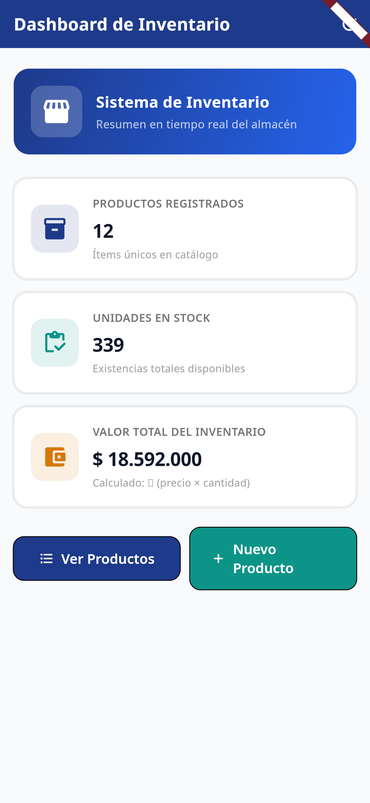 | 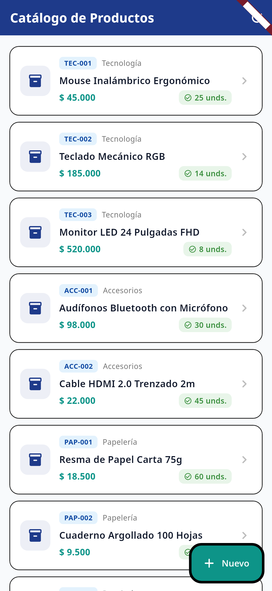 | 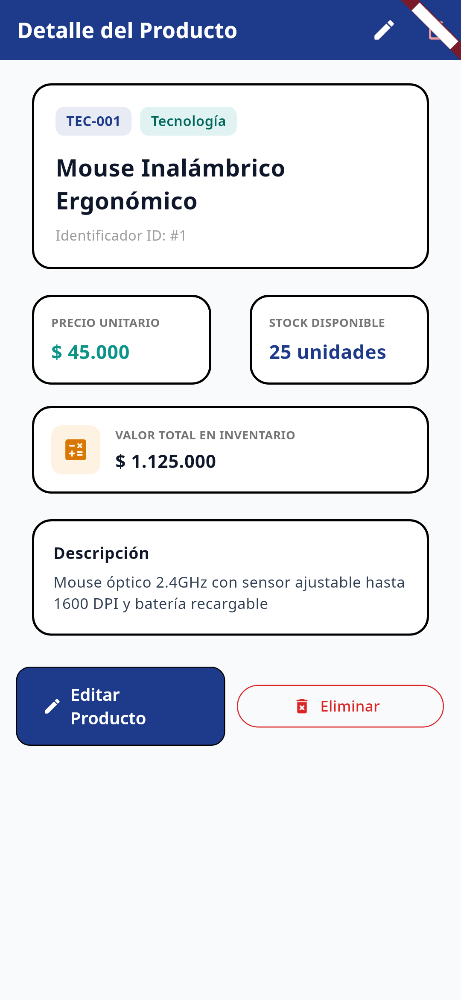 |

| 04. Formulario de Registro | 05. Errores de Validación (422) | 06. Notificación Producto Creado |
|:---:|:---:|:---:|
| 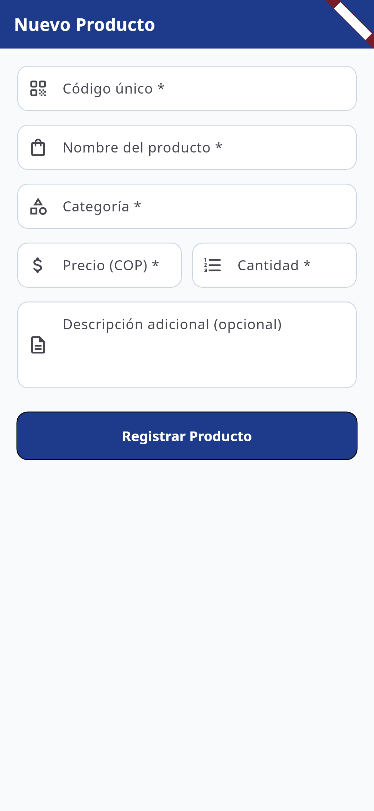 | 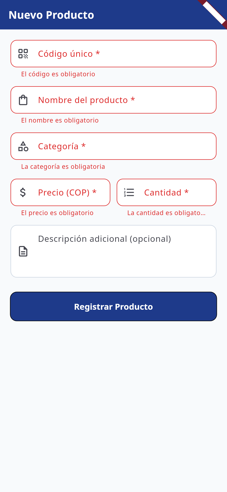 | 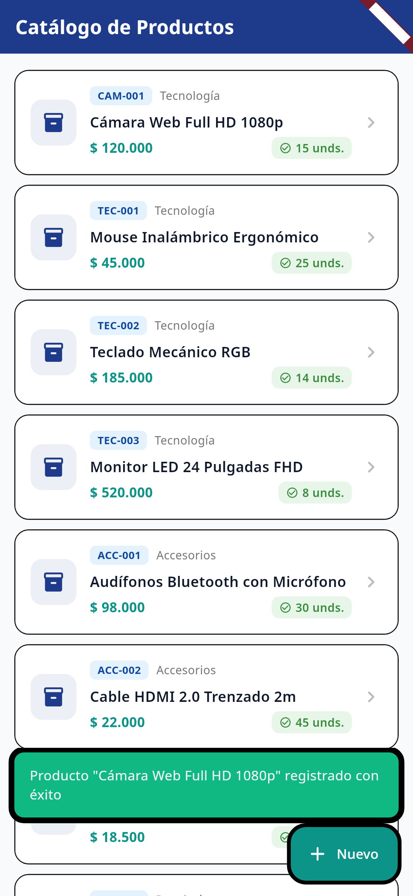 |

| 07. Formulario de Edición | 08. Notificación Producto Editado | 09. Diálogo de Confirmación |
|:---:|:---:|:---:|
| 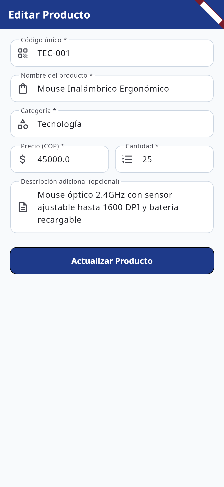 | 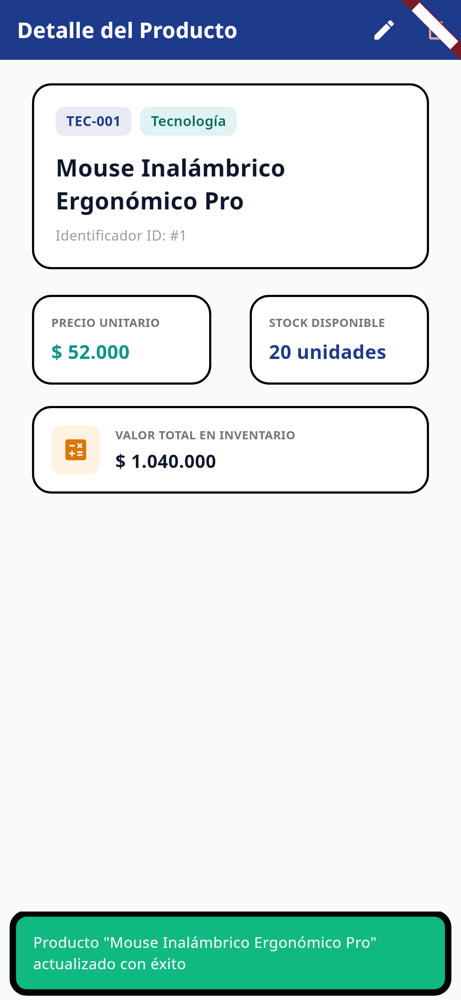 | 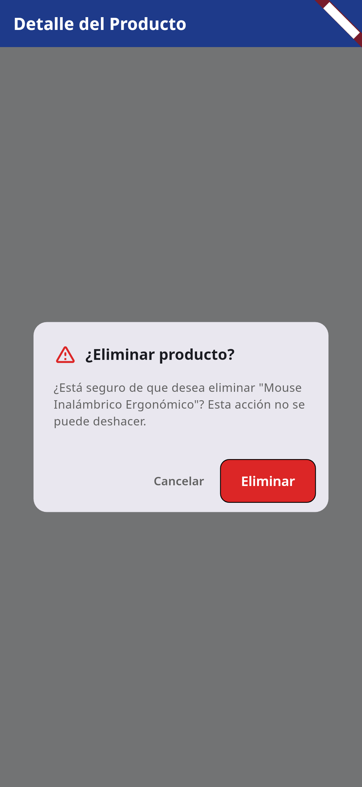 |

| 10. Notificación Producto Eliminado | 11. Dashboard Actualizado | 12. Estado de Carga |
|:---:|:---:|:---:|
| 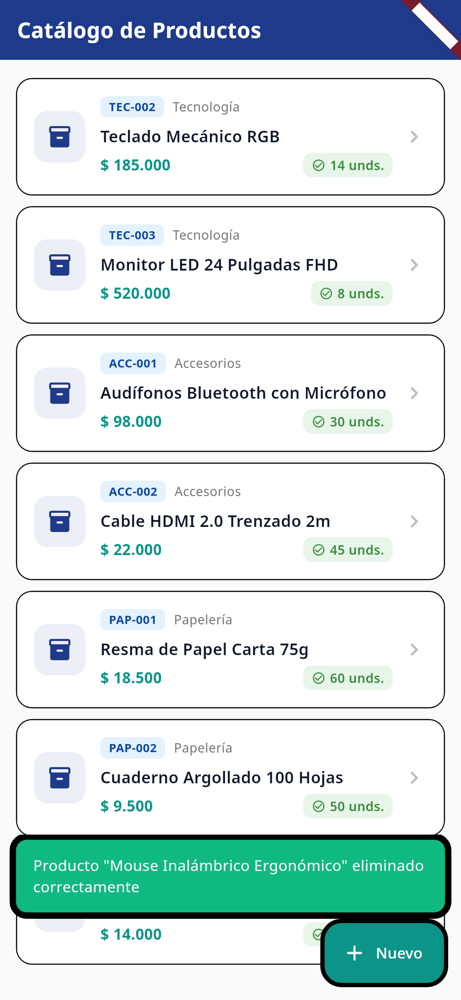 | 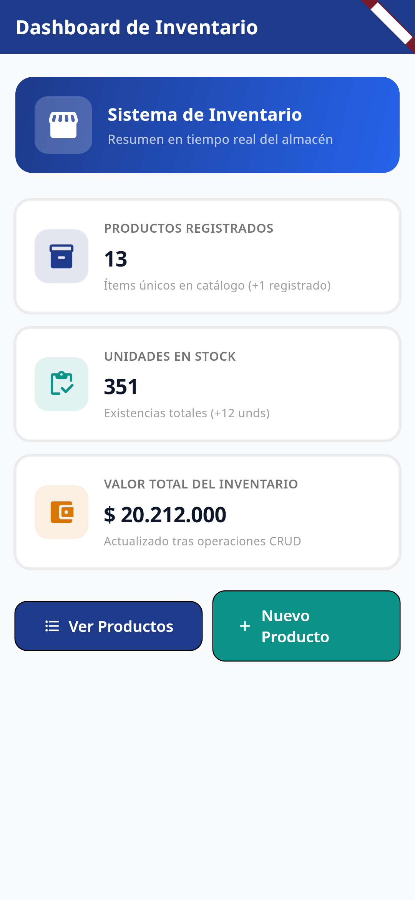 | 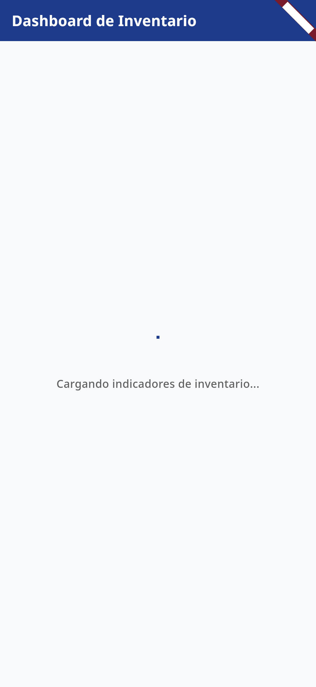 |

| 13. Estado de Error con Reintento | 14. Estado de Catálogo Vacío | |
|:---:|:---:|:---:|
| 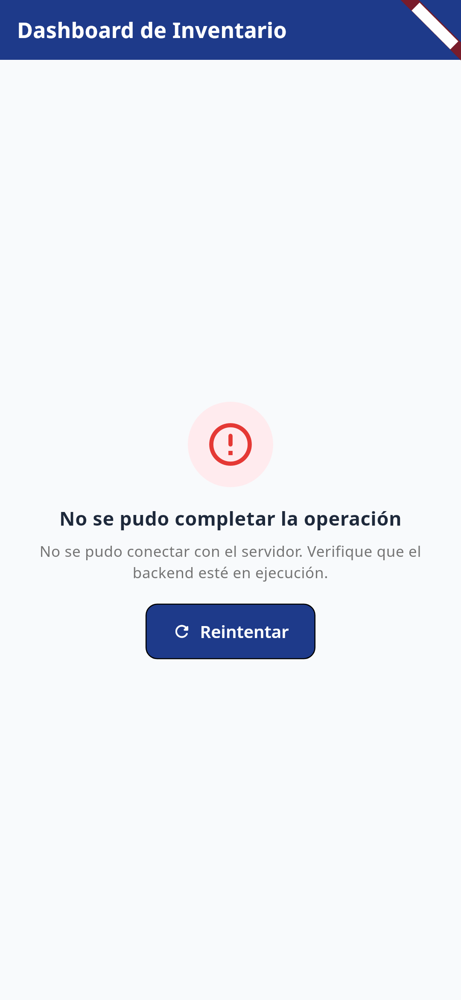 | 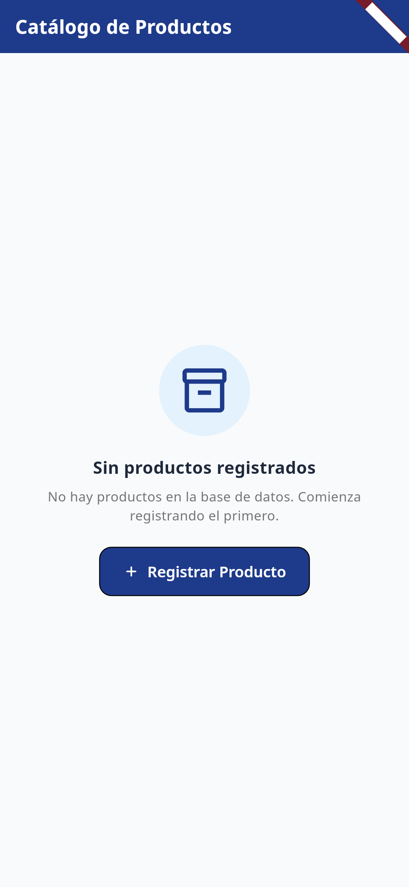 | |

---

## Batería de Pruebas y Evidencias

El proyecto incluye archivos de verificación automatizada:
1. **Pruebas de la API REST:** Ubicadas en `backend/api-tests.http`, compatibles con la extensión REST Client y Thunder Client.
2. **Registro de Ejecución de Pruebas:** Archivo de texto en `docs/evidencias/api_pruebas.txt` con la traza completa de peticiones y respuestas HTTP.
3. **Persistencia SQLite:** Archivos `docs/evidencias/db_datos_antes_reinicio.txt` y `docs/evidencias/db_datos_despues_reinicio.txt` que acreditan la invariabilidad de los datos tras detener y reiniciar el servidor Node.js.
4. **Pruebas Unitarias de Flutter:** Ubicadas en `frontend/test/widget_test.dart` ejecutables con `flutter test`, verificando serialización y deserialización de modelos con 100% de éxito.
5. **Informe Académico APA 7:** Generable localmente mediante `python3 scripts/generate_pdf.py` produciendo el documento `entregables/PDF_Evidencias.pdf` (ignorado en el repositorio según las directrices).

---

## Despliegue

**No aplica (desarrollo local)**.

De acuerdo con los requisitos del proyecto, el despliegue en entornos de nube (Render, Railway, Fly.io, etc.) es opcional y no ha sido implementado. La solución está diseñada y verificada para su ejecución en entorno de desarrollo local, escuchando en `0.0.0.0:3000` y persistiendo datos en un archivo SQLite físico local.

---

## Seguridad y Buenas Prácticas

- **Cero Secretos en el Repositorio:** Ni contraseñas, ni cadenas de conexión, ni tokens de autenticación se encuentran expuestos en el código fuente. Todas las configuraciones sensibles o de entorno se gestionan mediante archivos `.env` excluidos explícitamente en el `.gitignore`.
- **Plantillas `.env.example`:** Se proveen plantillas sin datos sensibles tanto para `backend/.env.example` como para `frontend/.env.example`.
- **Integridad de Base de Datos:** Base de datos SQLite operada con modo WAL (Write-Ahead Logging) para prevenir bloqueos por lectura concurrente.
- **Configuración Android:** Se habilitó el tráfico HTTP local en claro (`usesCleartextTraffic="true"`) exclusivamente para permitir la comunicación local con el servidor de desarrollo dentro de `android/app/src/main/AndroidManifest.xml`.